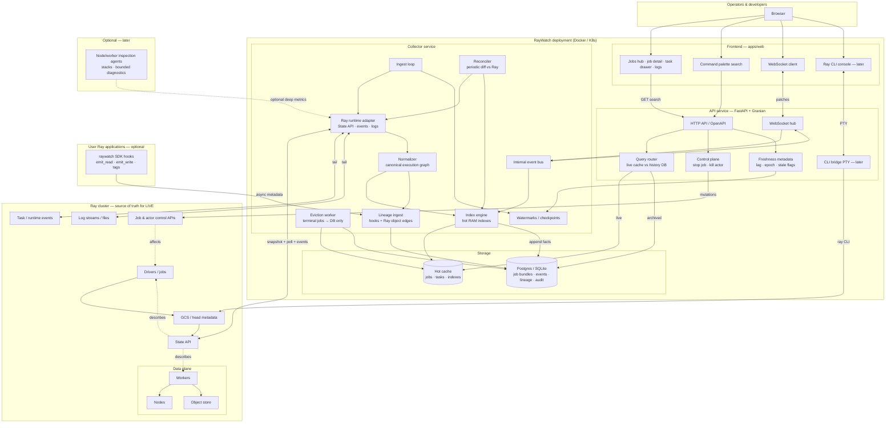
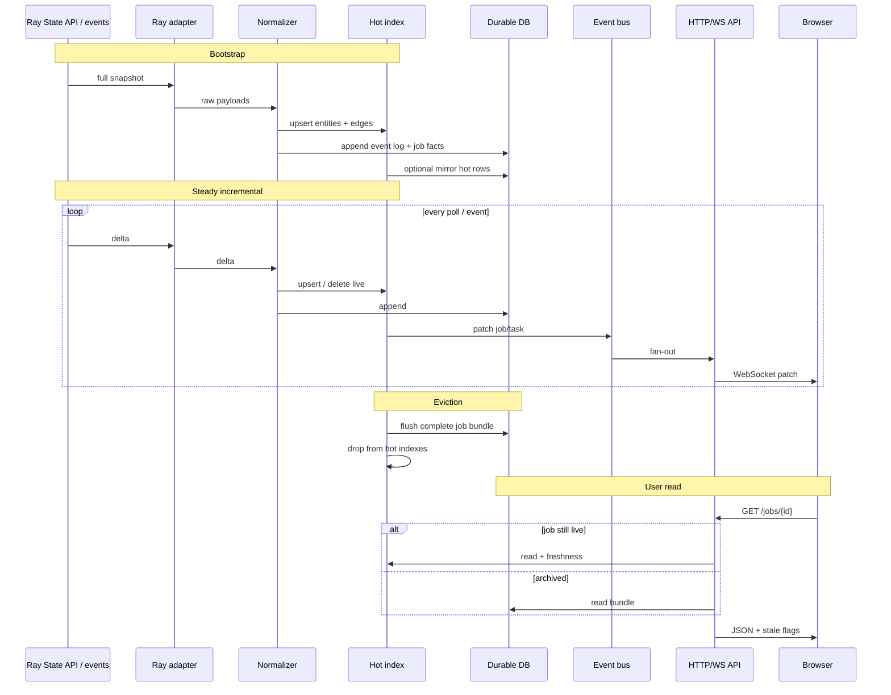
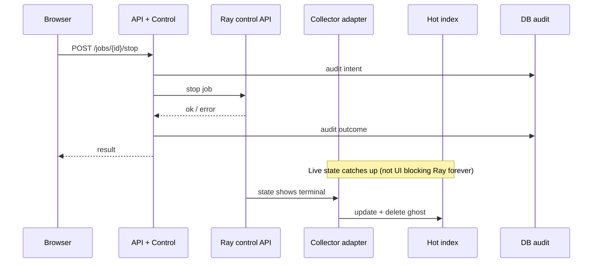
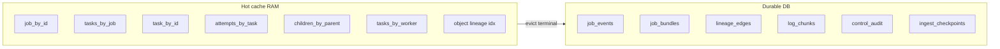
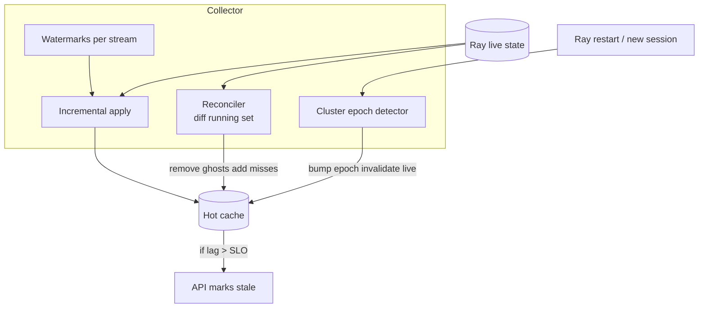
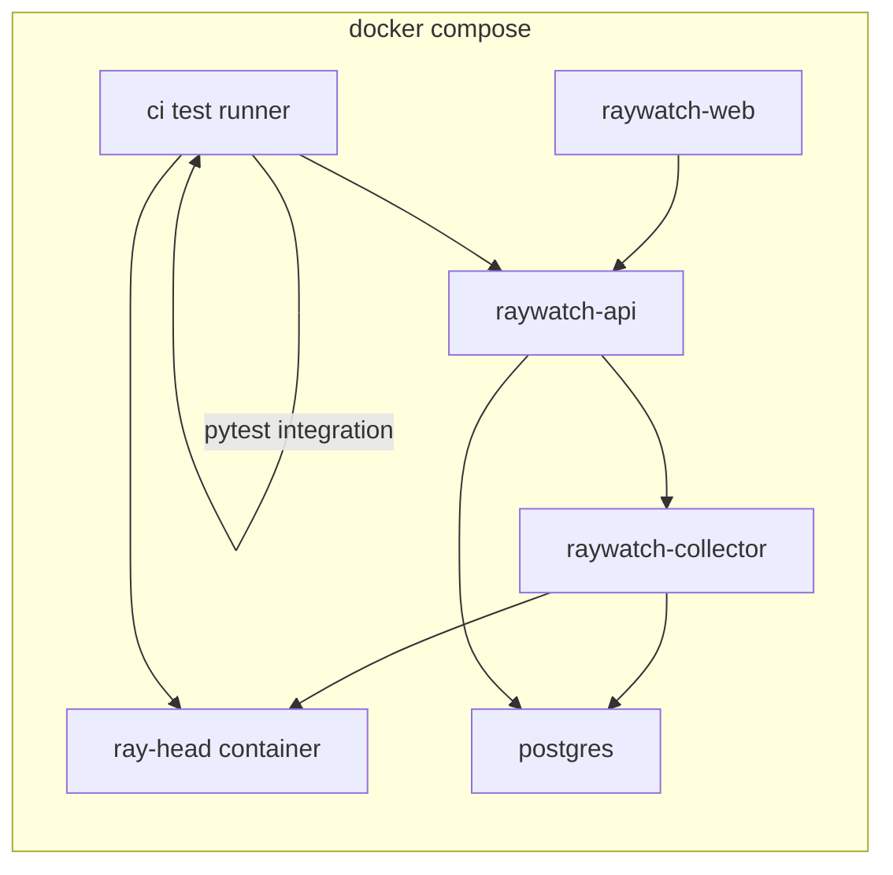

# Full system diagram

Read top → bottom: **you** → **RayWatch** → **Ray**. Solid arrows = request/command; dashed = data/sync.

**How to use this doc:** Skim diagram 1, then read **“What each part does”** below it. Diagrams 2–3 are timelines (what happens when you load a job or click Stop). Diagrams 4–6 zoom into storage, sync, and Docker.

---

## 1. System context (everything on one page)

### What each part does

#### Browser & frontend (`apps/web`)

| Piece | What it does |
|-------|----------------|
| **Jobs hub · job detail · task drawer · logs** | The product UI: list many jobs, drill into one job’s tasks (nested), open a task side panel, read logs at job or task scope. Never talks to Ray directly—only to RayWatch API. |
| **Command palette search** | Fast jump: paste a job/task/actor/worker/object id (or search text) and navigate to the right screen. |
| **WebSocket client** | Keeps the page fresh: when the collector updates a job you’re viewing, small patches arrive instead of reloading the whole cluster. |
| **Ray CLI console (later)** | In-browser terminal running the `ray` CLI against your cluster (address configured server-side), for power users. |

#### API service (FastAPI + Granian)

| Piece | What it does |
|-------|----------------|
| **HTTP API / OpenAPI** | REST endpoints: list jobs, get task details, search, fetch logs, export bundles. Contract the frontend and tests rely on. |
| **WebSocket hub** | Manages browser subscriptions (e.g. “I’m on job X”) and pushes incremental updates from the collector. |
| **Query router** | Decides where to read: **live** data from RAM cache vs **archived** job from DB after Ray forgot or job evicted from hot memory. |
| **Control plane** | Handles **actions**: stop job, kill actor, etc. Calls Ray’s control APIs and records success/failure. |
| **CLI bridge (later)** | Backend PTY that runs `ray` subprocess for the console UI. |
| **Freshness metadata** | Attaches honesty fields to responses: last sync time, lag, cluster epoch, `stale: true` when we’re behind Ray or Ray is down. |

#### Collector service (background brain)

| Piece | What it does |
|-------|----------------|
| **Ingest loop** | Runs continuously: wake up, pull changes from Ray, apply them, sleep/backoff. This is the “incremental gainer”—not one giant snapshot per page load. |
| **Ray runtime adapter** | **Only** module that calls Ray (State API, events, logs). Hides Ray version quirks from the rest of the codebase. |
| **Normalizer** | Converts Ray’s JSON into **our** graph: jobs, tasks, attempts, workers, objects, edges, state transitions. |
| **Index engine** | Updates in-memory maps (`task_by_id`, `tasks_by_job`, …) so API lookups are instant. |
| **Reconciler** | Periodically compares cache vs Ray for **running** work; removes “ghost” tasks, adds misses. **Ray wins** on live state. |
| **Eviction worker** | Moves **finished** jobs out of RAM into the DB after a delay; hub stays fast at scale. |
| **Lineage ingest** | Records metadata lineage (datasets, artifacts, tags) from SDK hooks and from Ray object/task edges. |
| **Internal event bus** | In-process pub/sub: index changed → notify WebSocket hub (and metrics). |
| **Watermarks / checkpoints** | Remembers “how far we read” per stream so restart resumes incrementally; feeds freshness. |

#### Storage

| Piece | What it does |
|-------|----------------|
| **Hot cache** | RAM holding **active + recent** jobs/tasks and indexes. Optimized for speed; bounded size. |
| **Postgres / SQLite** | Disk: full **job bundles**, event log, lineage, log chunks, control audit, ingest checkpoints. Survives Ray reset and RayWatch restart. |

#### Ray cluster (you don’t build this—you connect to it)

| Piece | What it does |
|-------|----------------|
| **Drivers / jobs** | Your Python scripts that call `ray.init()` and submit work. Each submission is a **job**. |
| **GCS / head** | Global metadata store on the head node; backbone of what State API exposes. |
| **State API** | HTTP API listing jobs, tasks, actors, workers, nodes, objects—what we poll for live state. |
| **Task / runtime events** | Finer-grained lifecycle stream when available (better timelines than poll alone). |
| **Logs** | Worker/driver log bytes we tail or fetch for the log viewer. |
| **Job & actor control APIs** | What **Control** calls to stop jobs or kill actors. |
| **Workers / nodes / object store** | Where tasks actually run and where object refs live; State API describes them. |

#### Optional extras

| Piece | What it does |
|-------|----------------|
| **raywatch SDK hooks** | Optional calls in your app (`emit_read`, tags, …) so **logical** lineage isn’t only inferred from Ray refs. Fire-and-forget; must not break jobs if RayWatch is down. |
| **Inspection agents (later)** | Small agents on nodes for stacks/process health—only if Ray’s APIs aren’t enough. |

---

## 2. Read path (observe) — sequence

**What this shows:** How data flows from Ray into RAM and DB, and how your browser loads a job without Ray being hit on every click.

---

## 3. Write path (act) — sequence

**What this shows:** Stop job is a short command to Ray; the UI gets an immediate answer; **truth** in the dashboard updates when the collector sees Ray’s new state (not fake optimism forever).

---

## 4. Data model inside storage

**What this shows:** What lives in **fast RAM** vs **durable disk**. Indexes are for navigation; DB holds the full retained job story.

| Index / table | What it does |
|---------------|----------------|
| `job_by_id` | O(1) job lookup for live hub and detail header. |
| `tasks_by_job` | List tasks inside a job without scanning all tasks in the cluster. |
| `task_by_id` | Open task drawer instantly. |
| `attempts_by_task` | Retries and failure history per task. |
| `children_by_parent` | Nested task tree (parent/child remote calls). |
| `tasks_by_worker` | “What’s running on this worker?” |
| `object lineage idx` | Quick who-produced / who-consumed for an object ref. |
| `job_events` | Append-only timeline of everything we saw for auditing and replay. |
| `job_bundles` | Frozen complete job snapshot for archived view. |
| `lineage_edges` | Asset/dataset graph edges tied to jobs/tasks. |
| `log_chunks` | Stored log text or pointers we captured. |
| `control_audit` | Who stopped what and whether Ray accepted it. |
| `ingest_checkpoints` | Watermarks so restart doesn’t reprocess from zero incorrectly. |

---

## 5. Sync & anti-desync (collector internals)

**What this shows:** How we avoid lying when Ray and cache disagree—epoch on restart, reconcile loop, stale flag when lag is too high.

| Piece | What it does |
|-------|----------------|
| **Watermarks** | Per-stream cursor (time/version) for incremental ingest. |
| **Incremental apply** | Apply one delta at a time to cache + DB append. |
| **Reconciler** | Full diff for running entities; delete ghosts, add missing. |
| **Cluster epoch detector** | Ray restarted → new session → invalidate old live rows so ids don’t mix. |
| **API marks stale** | If ingest lag exceeds SLO, UI shows degraded instead of false LIVE. |

---

## 6. Dev / CI (Docker kit)

**What this shows:** Same stack contributors and GitHub Actions use—Ray in a container, real Postgres, pytest integration without installing Ray on the laptop.

| Container | What it does |
|-----------|----------------|
| **ray-head** | Real Ray cluster for integration tests and local dev. |
| **postgres** | Same DB layer as production history/lineage. |
| **raywatch-collector** | Ingest service image. |
| **raywatch-api** | API + WebSocket image. |
| **raywatch-web** | Static UI served to browser. |
| **ci test runner** | Runs `pytest -m integration` against the compose network. |

---

## Quick mental model

1. **Collector** = always watching Ray, writing RAM + disk.  
2. **API** = answers the UI from RAM (live) or disk (archive); never scans Ray per click.  
3. **Control** = buttons/CLI that **change** Ray; collector confirms the result.  
4. **Reconciler + freshness** = don’t stay desynced from Ray without telling the user.

## Related docs

- [architecture.md](./architecture.md) · [sync-with-ray.md](./sync-with-ray.md) · [architecture-levels.md](./architecture-levels.md)
