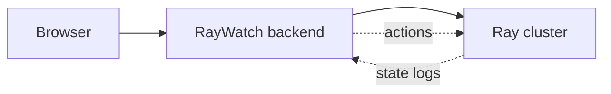
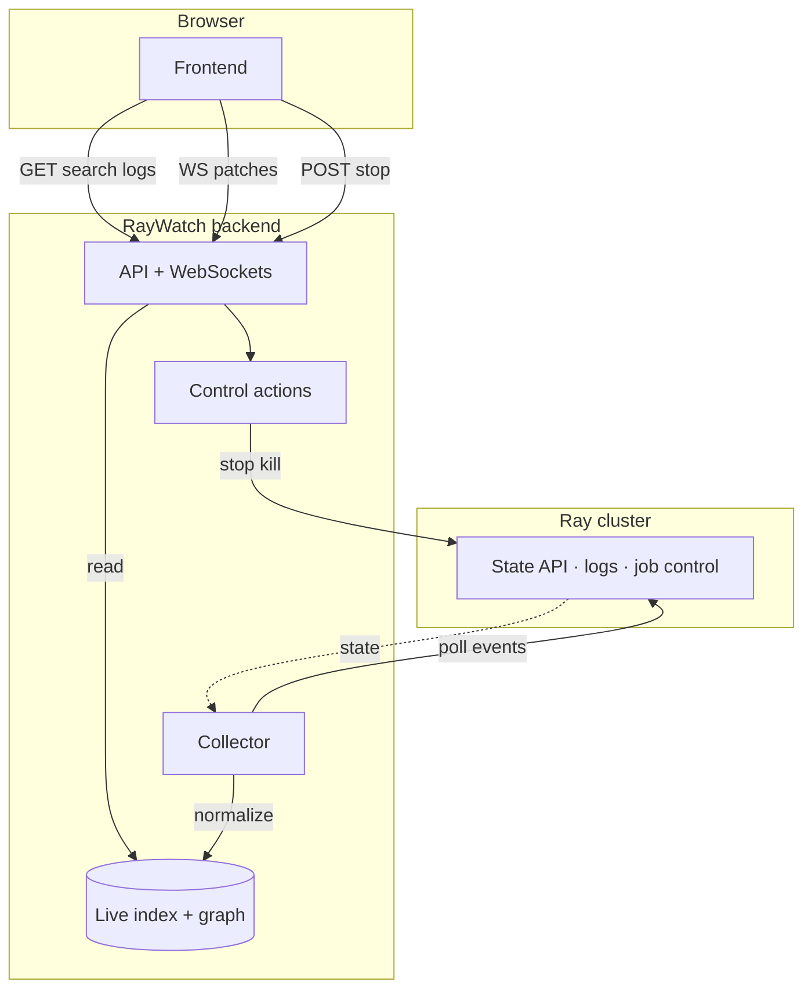
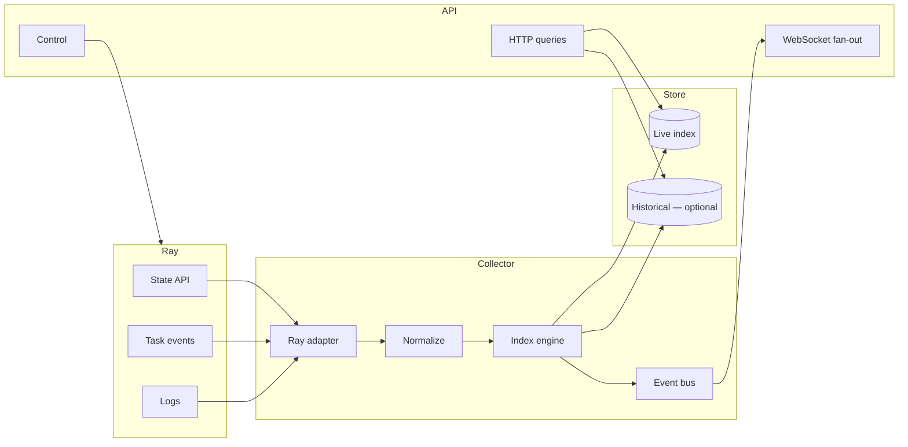
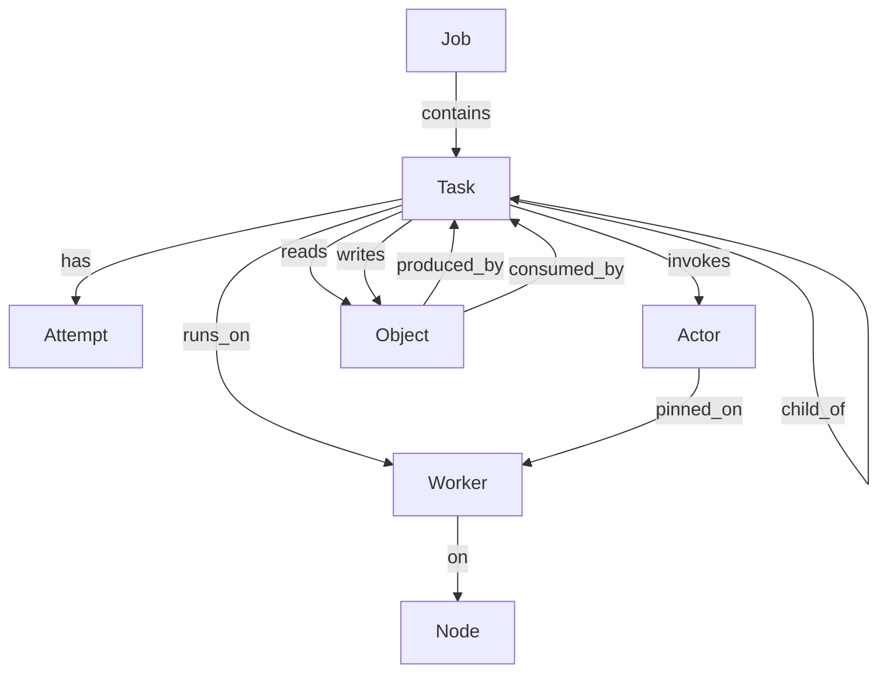

# Architecture (five levels)

Progressive explanation from simplest to full system. Read one level at a time.

---

## Level 1 — Who talks to whom

Ray **runs** work. RayWatch **backend** reads Ray and serves the **browser**; the UI never calls Ray directly.

---

## Level 2 — Read path vs write path

Two pipelines in the backend: **observe** (continuous) and **act** (on demand).

| Path | Flow | Purpose |
|------|------|---------|
| **Read** | Ray → Collector → index → API → UI | Fast dashboards; no full-cluster fetch per click |
| **Write** | UI → API → Control → Ray | Stop job, kill actor, etc.; index updates on next ingest |

---

## Level 3 — Inside the backend (read pipeline)

The **collector** owns freshness; the **API** only reads materialized state and pushes deltas to open UI sessions.

| Step | Component | What it does |
|------|-----------|--------------|
| **1. Ingest** | **Ray adapter** | Snapshot on startup; then poll/events for jobs, tasks, actors, workers, nodes, objects, log tails. All Ray-specific HTTP/SDK calls stay here. |
| **2. Normalize** | **Normalizer** | Map Ray JSON → **canonical entities + edges** (independent of Ray dashboard shapes). Emit upserts, deletes, transition events. |
| **3. Store** | **Index engine** | Update **live** indexes (`task_by_id`, `tasks_by_job`, …). Optionally append **historical** rows for completed work. |
| **4. Query** | **HTTP API** | UI calls `GET /jobs`, `GET /tasks/:id?expand=…` — **only** the index, never Ray per request. |
| **5. Stream** | **Event bus → WebSocket** | After index updates, push **patches** to clients subscribed to a job/task channel. |
| **Write** | **Control** | Side path: `POST /jobs/:id/stop` → Ray; collector picks up new state on next ingest (no direct UI → Ray for reads). |

**Why split collector vs API:** Ray I/O is slow and bursty; request handlers stay fast and predictable.

---

## Level 4 — Execution graph (data model)

Everything RayWatch stores is a **graph**: **nodes** (entities) and **edges** (relationships). The UI “nesting” and inspector are just walks on this graph.

### Entities (nodes)

| Entity | Meaning |
|--------|---------|
| **Job** | One driver submission (Ray job id). |
| **Task** | One logical unit of work (remote function or actor method). |
| **Attempt** | One run of a task (retries = new attempts). |
| **Actor** | Stateful remote class instance. |
| **Worker** | Process running tasks/actors. |
| **Node** | Machine hosting workers. |
| **Object** | Object ref in the store (dependency handle). |

### Relationships (edges)

### Typical debug walks (what the UI does)

| You select… | Graph walk |
|-------------|------------|
| **Task** | task → attempts, worker → node, actor, parent/child tasks, input/output objects, transitions |
| **Job** | job → tasks (paginated / grouped), aggregate counts by state |
| **Object** | object → producer task, consumer tasks (“who is blocked on this?”) |
| **Actor** | actor → worker → node, running/pending methods as tasks |

### Indexes (why lookups are fast)

Same information as the graph, stored for query—not for drawing the whole cluster at once:

- `job_by_id`, `tasks_by_job`, `task_by_id`, `attempts_by_task`
- `worker_by_id`, `workers_by_node`, `tasks_by_worker`
- `actor_by_id`, `tasks_by_actor`
- `children_by_parent_task`, `objects_by_task_in/out`

The **normalizer** writes entities + edges; the **index engine** maintains these maps.

---

## Level 5 — Scale & ops

*(Next: retention, historical store, 100k jobs, WS fan-out.)*
