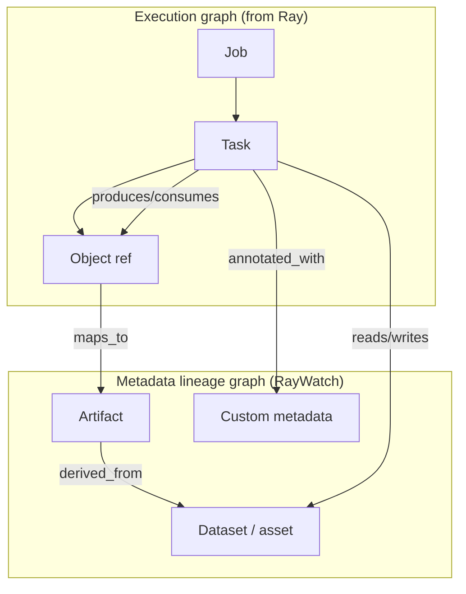

# Metadata lineage layer

RayWatch extends beyond **execution telemetry** (jobs, tasks, workers) into a **metadata lineage layer**: who produced what, what consumed it, and which **logical assets** (datasets, models, tables, files, features) flow through Ray workloads—**stored and retained** independently of Ray’s ephemeral runtime state.

Ray still executes work. RayWatch **records and queries lineage** for ops, debugging, compliance, and reuse after cluster reset.

## Scope

| In scope | Out of scope (v1) |
|----------|-------------------|
| Logical **metadata nodes** (assets) and **edges** (dependencies) | Replacing Ray’s object store or scheduler |
| Linking lineage to **Ray execution graph** (job, task, object ref) | Full data catalog for every byte on disk without user/opt-in hooks |
| **Retention** on disk with execution history | Guaranteed lineage without any app instrumentation for custom assets |
| Search: “what tasks read dataset X?” | Automatic inference of business meaning from arbitrary Python |

## Two graphs, one system

- **Execution graph** — ingested from Ray (State API, events).  
- **Lineage graph** — **metadata** nodes and edges we own; some edges **inferred** from Ray (object producer/consumer), others **declared** by the application.

## Metadata node types (canonical)

| Type | Examples |
|------|----------|
| **Asset** | `s3://bucket/path`, `hive.db.table`, `feature_set:v3` |
| **Artifact** | Model checkpoint, parquet shard, eval metrics blob |
| **Run / job link** | Pointer to execution `job_id` (not duplicate of full job store) |
| **Namespace / project** | Team, env, cost center |
| **Custom** | JSON schema’d user metadata (version, git sha, pipeline stage name) |

Nodes have stable **URNs** inside RayWatch (e.g. `asset:s3:…`, `artifact:job:…:task:…:out:0`) so they survive Ray id recycling after reset.

## Edge types

| Edge | Meaning |
|------|---------|
| `derived_from` | Asset/artifact B built from A |
| `read_by` / `written_by` | Task or job touch asset |
| `produced_by` | Artifact created by task attempt |
| `consumed_by` | Task blocked on / read artifact |
| `same_as` | Alias (two URNs, one logical asset) |
| `annotates` | Metadata blob attached to task/job/asset |

## How lineage enters the system

| Source | Mechanism |
|--------|-----------|
| **Ray (automatic)** | Object ref producer/consumer, task parent/child, job id — baseline **technical lineage** |
| **Driver / task hooks** | Lightweight SDK: `raywatch.lineage.emit_read(asset)`, `emit_write(asset)`, `emit_artifact(...)` |
| **Actor diagnostics** | Optional bounded `diagnostics()` returning declared inputs/outputs (no arbitrary pickle) |
| **Batch import** | CI git metadata or user tags attached at job submit |
| **UI** | Manual tags on job (later, admin) |

Hooks should be **non-blocking** (async buffer → collector); never fail the user’s Ray job if RayWatch is down.

## Storage and retention

Lineage is **append-only** in the same durable tier as [persistence-and-history.md](./persistence-and-history.md):

- **Event log**: `(time, edge_type, from_urn, to_urn, job_id, task_id, attempt, payload_json)`  
- **Indexes**: by asset URN, by job, by task, upstream/downstream N hops  
- **Retention**: configurable; lineage often kept **longer** than raw worker logs  

Live RAM may cache **recent lineage neighborhood** for an open job; **authoritative** graph for old jobs is on disk.

## Query API (planned)

| Query | Example |
|-------|---------|
| Upstream | “What datasets fed this job?” |
| Downstream | “What jobs consumed `feature_set:v3`?” |
| Impact | “If this table is wrong, which running jobs are affected?” (live + recent) |
| Bridge | `GET /lineage/asset/{urn}?direction=both&depth=3` + link to execution inspector |

UI: **Lineage** tab on job + asset search in command palette; small graph for **bounded** depth only (not whole cluster).

## Relation to Dagster-style lineage

Dagster lineage is **definition-time** (ops/assets in code). RayWatch lineage is **runtime-first** on Ray:

- Best when apps **declare** logical assets at runtime (hooks) or map Ray object refs → registered assets.  
- Optional future: import static DAG hints from user repo (out of band), not required for v1.

## Implementation order (within RayWatch roadmap)

1. Durable execution history (prerequisite)  
2. Baseline technical lineage from Ray object/task edges  
3. SDK + event ingest for declared assets  
4. Indexes + job UI lineage tab (depth-limited)  
5. Cross-job asset search and impact  
6. External catalog import (only if product asks for it)  

## Security

Lineage payloads may contain **paths, table names, model names**—treat as sensitive as logs. Same auth as API; no PII in default hooks; document what `emit_*` should not send.

## Related

- [persistence-and-history.md](./persistence-and-history.md)  
- [architecture.md](./architecture.md)  
- [product-vision.md](./product-vision.md)  
