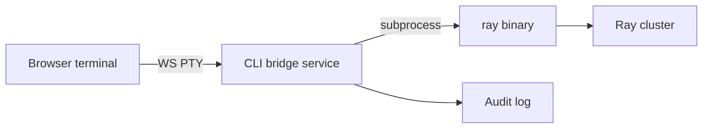

# Ray CLI console (hosted terminal)

Run **`ray` CLI commands from the browser** against the connected cluster—same outcome as SSH to the head and running `ray …`, without leaving RayWatch.

This complements **Control** (structured buttons like Stop job): the console is for **power users** and gaps where Ray has no API button yet.

## User experience

| Surface | Behavior |
|---------|----------|
| **Console page** | Full-width terminal (monospace, dark); `RAY_ADDRESS` (and auth token if any) **pre-injected**—user does not paste cluster address. |
| **Contextual console** | From a job/task row: “Open in CLI” pre-fills e.g. `ray job status <id>` or copies id into session banner. |
| **Session** | One PTY session per user tab; reconnect shows new session (no shared shell between users). |
| **Output** | Streaming stdout/stderr over WebSocket; Ctrl+C sends interrupt to PTY. |

**Stack (frontend):** [xterm.js](https://xtermjs.org/) (or similar) + WebSocket to backend PTY bridge.

## Architecture

- **CLI bridge** lives in RayWatch backend (or a sidecar container with `ray` installed).
- Spawns **`ray`** (or a restricted wrapper) with env from server config—**never** user-supplied `RAY_ADDRESS`.
- Optional: **`rw-ray` wrapper** that only allows subcommands in an allowlist before execing real `ray`.

**Not in scope:** arbitrary `ssh` to worker nodes from the browser (separate feature / inspection agents).

## Modes (phased)

| Mode | Phase | Description |
|------|-------|-------------|
| **Guided commands** | v1 console | Palette of safe commands (`ray status`, `ray job list`, `ray job status`, `ray stop`, …); renders output in terminal styling **without** full PTY. |
| **Allowlisted PTY** | v2 | Real shell, but only `ray *` lines accepted; block `rm`, `curl`, pipes to shell, etc. |
| **Full PTY** | later / admin only | Bash with `ray` on PATH—**admin role only**, strong warnings, full audit. |

Default recommendation: ship **guided** first, then **allowlisted PTY**; full PTY only behind explicit deploy flag.

## Security (non-negotiable)

| Requirement | Rationale |
|-------------|-----------|
| **Authentication** | Console disabled without login (or mTLS / VPN-only deploy). |
| **Authorization** | Roles: `viewer` (read-only ray commands), `operator` (+ stop/kill), `admin` (+ full PTY if enabled). |
| **Audit** | Every command line + exit code + user id + timestamp stored. |
| **Rate / session limits** | Max concurrent sessions per user; idle timeout. |
| **No secrets in browser** | Ray token stays server-side env only. |
| **Sandbox** | Bridge runs in container with minimal filesystem; no cluster credentials on client. |

See [non-functional-requirements.md](./non-functional-requirements.md) SEC* items; console adds **SEC7** (below).

## API sketch

| Endpoint | Purpose |
|----------|---------|
| `WS /api/console/pty` | Bidirectional PTY stream (after auth) |
| `POST /api/console/exec` | One-shot allowlisted command (guided mode); returns streamed or JSON output |
| `GET /api/console/capabilities` | Allowed subcommands for this user role |

## Testing

- Unit: allowlist parser rejects `ray status; rm -rf /`.
- Integration: docker with ray CLI mock or minimal cluster; `ray status` returns expected output in WS.
- E2E: login → open console → run allowlisted command → audit row exists.

## Relation to Control

| Control (buttons) | CLI console |
|-------------------|-------------|
| Fixed actions, validated payloads | Free-form `ray` syntax |
| Best for most users | Best for operators and new Ray flags |
| Same **RuntimeAdapter** / Ray client where possible | Prefer delegating to `ray` subprocess for parity with docs |

## Phase in roadmap

| Item | Phase |
|------|-------|
| Guided ray commands + output panel | **after** v1 jobs UI + auth stub |
| Allowlisted PTY | **v2** |
| Full PTY | **optional**, admin-only |

## Related

- [frontend-features.md](./frontend-features.md)  
- [architecture-levels.md](./architecture-levels.md) (write path)  
