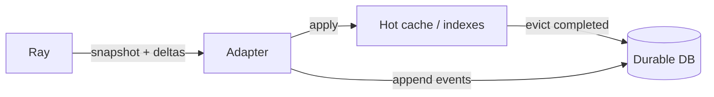

# Staying in sync with Ray

Ray is **source of truth for live runtime**. RayWatch is a **materialized view** that must not **lie** when it diverges from Ray. History on disk is **what we recorded**; the **live index** must track Ray or say clearly that it does not.

## Rules

| Rule | Meaning |
|------|---------|
| **Ray wins (live)** | On conflict, live queries reflect Ray after the next successful reconcile—not stale cache. |
| **Never fake live** | If we cannot reach Ray or ingest is behind, UI shows **stale** / **degraded**, not silent wrong state. |
| **History is immutable** | Past job bundles are a **snapshot in time**; they do not auto-update when Ray resets. |
| **Incremental + verify** | Steady state = deltas; periodically **anchor** with partial or full reconcile. |

## Incremental sync (the “gainer”)

1. **Bootstrap:** full snapshot of entities Ray exposes (jobs, tasks, …) → populate hot cache + DB event log.  
2. **Steady:** task events / targeted polls → **upsert** and **delete** in cache (entity gone in Ray → remove from **live** index, keep in **history**).  
3. **Watermarks:** per stream `last_event_time` / `last_version` so restarts resume without pretending nothing happened.  
4. **Backpressure:** if Ray falls behind, widen poll or shed work—but **do not** serve “live” hub as authoritative without freshness metadata.

## Cache → DB (not desync with Ray)

| Layer | Role | Sync with Ray |
|-------|------|----------------|
| **Hot cache (RAM)** | Fast reads for **active** jobs/tasks | Updated only by collector; TTL/evict **completed** work to DB |
| **DB** | Durable history + cold job bundles | Append-only **facts we observed**; not a second live scheduler |
| **API reads (live)** | `?freshness=live` | Served from cache **only if** `last_reconcile_at` within SLO |

**Eviction:** when a job is terminal and age &gt; threshold, drop from hot indexes but **full bundle** remains in DB. Re-opening an archived job reads DB, not Ray.

## Reconciliation (anti-drift)

| Mechanism | Purpose |
|-----------|---------|
| **Periodic reconcile** | Every N minutes (config): re-list jobs/tasks in **running** set; diff against cache; fix orphans (in cache but not Ray) and misses (in Ray but not cache). |
| **Job-scoped resync** | User opens job → optional `force_reconcile(job_id)` if stale &gt; threshold. |
| **Cluster epoch** | On `ray start` / GCS session change, bump epoch; mark all prior live rows **stale** until snapshot completes. |
| **Deletes** | Ray removed entity → **delete from live index**; do not leave ghost RUNNING tasks. |
| **Monotonic versions** | Per-entity `observed_version` or `updated_at` from Ray; ignore older out-of-order events. |

## API contract for honesty

- Response headers or JSON: `ray_reachable`, `last_successful_ingest_at`, `ingest_lag_ms`, `cluster_epoch`.  
- `GET /jobs` default: **running + recent** with freshness.  
- `GET /jobs/{id}`: if job only in DB (archived), `source: history`; if live, `source: cache` + reconcile time.

## Failure modes

| Situation | Behavior |
|-----------|----------|
| Ray down | Live hub frozen or empty; banner **cannot sync**; history still works. |
| Collector stuck | API serves cache with **stale** badge; readiness probe fails. |
| Ray reset | Live cache rebuilt from new snapshot; old jobs **only** in DB (labeled archived). |
| Duplicate ids after reset | New epoch; never merge new Ray ids with old DB rows without explicit lineage link. |

## Testing (must prove sync)

- Integration: submit job → RUNNING in UI → stop in Ray CLI → UI terminal within SLO.  
- Integration: remove task from Ray mock → disappears from **live** index, remains in **history** if was persisted.  
- Chaos: pause collector 60s → API returns `stale: true`.  
- Property: after reconcile, live index ⊆ Ray State API listing (for same epoch).

## Collector pacing (live Ray)

The API read path stays indexed; the collector still talks to Ray on a schedule. To reduce load on the head node:

| Env | Default | Meaning |
|-----|---------|---------|
| `RAYWATCH_SYNC_INTERVAL_SEC` | `5` | Seconds between sync ticks |
| `RAYWATCH_SYNC_TASKS_EVERY` | `1` | Fetch `/api/v0/tasks` every N ticks |
| `RAYWATCH_SYNC_CLUSTER_EVERY` | `2` | Fetch nodes, actors, objects, and cluster status every N ticks |

Jobs are refreshed every tick. Tasks and cluster metadata can lag by one interval when `EVERY` &gt; 1.

## Related

- [architecture-levels.md](./architecture-levels.md)  
- [persistence-and-history.md](./persistence-and-history.md)  
- [docker-and-devkit.md](./docker-and-devkit.md)  
