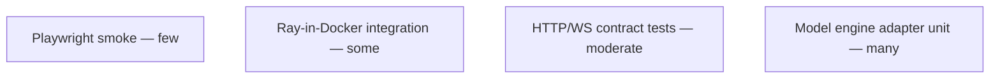

# Testing strategy

RayWatch is tested in **layers**: pure logic without Ray, contract tests without UI, short **live Ray** smokes in CI, and optional full e2e. Goal: contributors can run **fast tests locally**; CI proves **adapter + engine + API** against a real cluster.

## Test pyramid



## 1. Unit tests (no Ray, &lt;30s)

**Packages:** `model`, `engine`, `adapter-ray` (parser only).

| Area | What we assert |
|------|----------------|
| **Normalization** | Raw Ray JSON → canonical entities and edges; golden files under `tests/fixtures/ray/` (one file per Ray minor if shapes differ). |
| **Indexes** | After applying a batch of upserts/deletes, lookups (`task_by_id`, `tasks_by_job`, `children_by_parent`) match expected sets. |
| **Transitions** | Snapshot A → B produces expected timeline events (derive rules). |
| **Control mapping** | Action requests map to correct Ray client calls (mock httpx). |

**Tools:** pytest, pytest-asyncio / anyio, **httpx MockTransport** for adapter HTTP.

**Rule:** Any bug fix for wrong task/attempt identity adds or updates a **fixture + test** so it cannot regress.

## 2. API contract tests (no Ray, mock engine)

FastAPI app mounted with an **in-memory fake engine** preloaded with graph data.

| Check | Method |
|-------|--------|
| OpenAPI shape | Generated schema committed or snapshot-tested |
| Routes | `GET /jobs`, `GET /jobs/{id}/tasks`, `GET /tasks/{id}?expand=`, `POST /jobs/{id}/stop` return expected JSON |
| Errors | 404 unknown id, 409 action failed |
| WebSocket | Subscribe to job channel; inject engine event; client receives patch message |

**Tools:** pytest + **httpx ASGITransport** (async client against app).

Frontend uses the same contract via **MSW** handlers generated from or aligned with OpenAPI.

## 3. Integration tests (real Ray in Docker)

CI job: start **Ray head** in a container (pinned image matching `SUPPORTED_RAY_VERSIONS`), run collector + API (or test harness that drives adapter only).

| Scenario | Pass criteria |
|----------|----------------|
| **Smoke ingest** | `ray.init` + submit trivial `@ray.remote` job; within timeout, job appears in index with ≥1 task |
| **State progression** | Task reaches finished; transition or terminal state recorded |
| **Stop job** | Submit long-running job; `POST stop`; job ends; index reflects terminal state |
| **Logs (if API available)** | Job or task log stream returns non-empty tail for failing task fixture |

**Tools:** pytest markers `@pytest.mark.integration`, **testcontainers** or compose service `ray-head`, generous timeouts, retries only for known flaky Ray startup.

**Matrix:** one Ray minor per supported line (e.g. 2.9, 2.10) — not every patch release.

## 4. End-to-end (optional CI nightly or pre-release)

**Playwright:** UI against API + Ray compose stack — open jobs list, open job, open task drawer, confirm stop dialog.

Keep **1–3** stable scenarios; run on `main` nightly or release tags to avoid slowing every PR.

## 5. Non-functional checks

| Check | Where |
|-------|--------|
| **Ruff** lint + format | Every PR |
| **mypy / pyright** on `model`, `adapter-ray`, `api` | Every PR |
| **TypeScript** `tsc` + ESLint on `apps/web` | Every PR |
| **Indexed read SLOs** | `tests/nfr/test_api_latency.py` — p95 thresholds on RayWatch only |
| **Read-path regression** | `make perf` — p95 vs `tests/perf/baselines.json` (+15% slack); log layers in [perf-improvement-log.md](./perf-improvement-log.md) |
| **API contract (all routes)** | `tests/unit/test_api_routes_complete.py` — pagination, 404s, schema keys, logs error path |
| **Measurement stack** | `tests/unit/test_measurement_stack.py`, `test_measurement_regression_guards.py` — latency stats, perf harness, benchmark helpers |
| **Dashboard comparison (informational)** | `make benchmark` / `make benchmark-ray` — markdown table vs Ray `GET /api/v0/jobs` (no CI thresholds; Ray submit capped) |

## Local developer workflow

**Requirement:** A contributor with only Docker + Make clones the repo and runs **`make test`** (unit) and **`make test-integration`** (compose)—no host Ray install. See [docker-and-devkit.md](./docker-and-devkit.md).

```bash
# Fast (default) — host or dev container
make test
# equivalent: uv run pytest -m "not integration"

# Integration — Docker Ray + RayWatch services
make test-integration
# equivalent: docker compose -f compose/docker-compose.ci.yml run --rm test

# Full local stack for manual QA
docker compose -f compose/docker-compose.yml up
```

## CI pipeline (GitHub Actions sketch)

1. **lint** — ruff, pyright, web lint  
2. **unit** — `make test` on runner (no Ray)  
3. **integration** — build images, `make test-integration` (compose + pytest); retry once on flake  
4. **build-push** — publish `raywatch/*` images on release tag  
5. **e2e** (optional) — `make test-e2e` on nightly  

## What we do not rely on

- Manual clicking through Ray’s dashboard to verify RayWatch  
- Tests that hit a developer’s laptop Ray cluster (non-reproducible)  
- Snapshotting entire cluster state in every unit test (only **minimal** golden slices)

## Related

- [backend-technology.md](./backend-technology.md)  
- [architecture.md](./architecture.md)  
